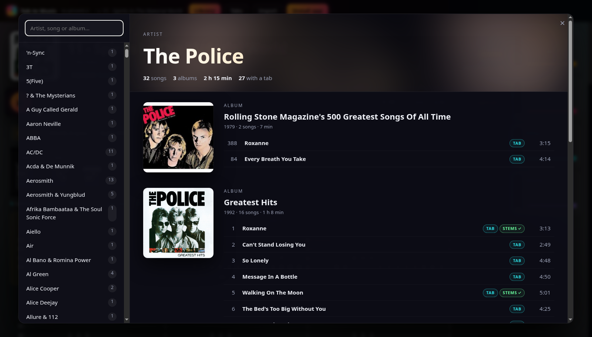
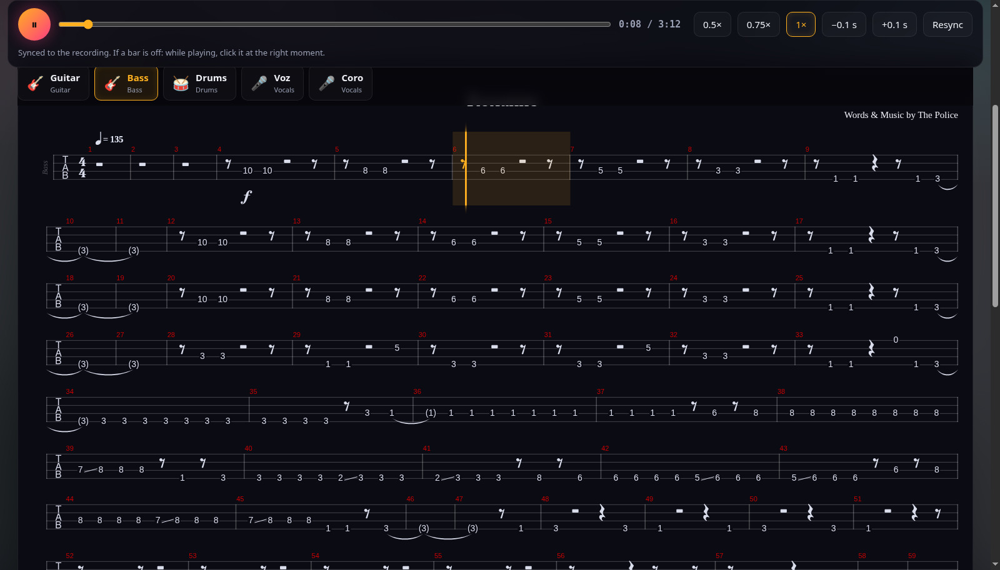
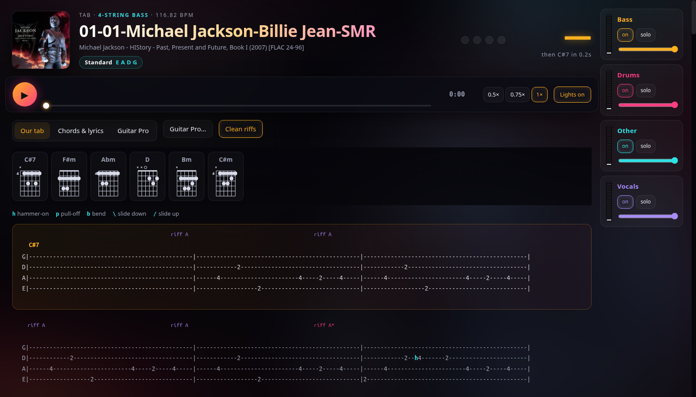

# Tab to Music

**Your Guitar Pro tabs, synced to the real recording — with the instruments you can turn off.**

Pick a song from your own music library: Tab to Music finds a matching Guitar Pro tab in your tab archives, syncs it bar by bar to the actual recording in a few seconds, and lets you play along with a cursor that follows the record. Split the recording into stems (bass, drums, vocals, other) and mute or solo the part you want to practice. No synthesized instruments, no cloud, no subscription: everything runs on your computer.

*Conceived and developed by [Getaweb](https://getaweb.it).* · [Italiano ↓](#italiano)



## What it does

| | |
|---|---|
| **Library** | All your music by artist and album, with covers, years, durations, and badges for *TAB* (a Guitar Pro tab exists) and *STEMS ✓* (already split). Covers missing from your files are fetched from the iTunes Search API. |
| **Auto-sync** | The tab is aligned to the full recording with a chromagram + dynamic time warping, the classic score-to-audio alignment: about 3 seconds per song, live versions and remasters included. Fix any bar by clicking it while it plays; nudge the whole tab ±0.1 s. |
| **Stems** | Demucs splits the recording into bass, drums, vocals and other. A mixer with level meters, mute and solo for each stem, and 0.5× / 0.75× slowdown without changing pitch. |
| **Tabs** | Rendered by [alphaTab](https://github.com/CoderLine/alphaTab), all tracks of the file (bass first), from your `.gp3/.gp4/.gp5/.gpx/.gp` archives (zip files are read without extracting) or from a file you upload. Mark the right version once ("✓ This one") and it always opens. |
| **Lyrics** | Synced lyrics from [LRCLIB](https://lrclib.net); speech-to-text (Whisper) only as a fallback. |
| **Import** (last resort) | When no tab exists anywhere, the app writes its own draft: bass/guitar transcription (Basic Pitch), recovered repeated notes, hammer-ons, slides, bends and vibrato, chords snapped to half bars with guitar chord diagrams, riff normalization, drop-D tuning. A draft to fix by ear, not an official transcription. |




## Install (Linux)

Requirements: Python 3.11 (Basic Pitch does not support newer versions yet), `ffmpeg`, `unzip`, Google Chrome or Chromium. An NVIDIA GPU makes stem separation ~5-10× faster but is not required.

```bash
git clone https://github.com/emanueledicuonzo-maker/tab-to-music.git
cd tab-to-music
python3.11 -m venv .venv-311
.venv-311/bin/pip install -r requirements.txt
./avvia.sh            # starts the local server on http://127.0.0.1:8777 and opens the app
```

Put your music in `~/Music` (or the folder `xdg-user-dir MUSIC` points to) and your Guitar Pro archives (`.zip` files whose name contains "tab" or "guitar pro") in the same folder. Processed songs are stored in `<Music>/tab/`.

The first time, use **Install app** to install it as a desktop app (PWA).

## How it works

```
your recording ──┐
                 ├─ chroma (librosa) ─┐
Guitar Pro tab ──┘   notes of every    ├─ DTW ─► bar → time in the recording ─► alphaTab cursor
                     track, as written ┘
recording ─► Demucs ─► bass · drums · vocals · other ─► mixer (mute / solo / meters)
```

- `tablatura/app.py` — local server: library, archives, sync, job queue.
- `tablatura/allinea.py` — tab-to-recording alignment.
- `tablatura/guitarpro.py`, `libreria.py`, `online.py` — tab archives, music index, LRCLIB and covers.
- `tablatura/*.py` (cli, trascrivi, pulizia, diteggiatura, accordi, tecnica…) — the Import pipeline ([details](docs/tablatura-cli.md), in Italian).
- `python -m pytest test` — tests for the parts that do not need models.

## Legal

The code is released under the **Apache License 2.0**: use it, change it, sell it — but keep the `NOTICE` file, which credits **Getaweb (https://getaweb.it)** as the original author. No tabs, music or audio are distributed with the project: bring your own. Guitar Pro is a trademark of Arobas Music; this project is not affiliated with Arobas Music, Songsterr, Soundslice or Ultimate Guitar.

---

## Italiano

**Le tue tablature Guitar Pro sincronizzate sul disco vero, con gli strumenti che puoi spegnere.**

Scegli una canzone dalla tua musica: Tab to Music trova la tablatura Guitar Pro nei tuoi archivi, la sincronizza battuta per battuta sul disco in pochi secondi, e suoni con il cursore che segue la registrazione. Separi le tracce (basso, batteria, voce, resto) e spegni o isoli la parte che vuoi studiare. Niente strumenti sintetizzati, niente cloud, niente abbonamenti: gira tutto sul tuo computer.

- **Libreria**: tutta la tua musica per artista e album, con copertine, anni, durate ed etichette *TAB* e *STEMS ✓*.
- **Sincronia automatica** sul disco intero (cromagramma + DTW), correggibile con un clic sulla battuta.
- **Tracce separate** con Demucs: mixer con livelli, mute, solo, rallentatore.
- **Tablature** dai tuoi archivi Guitar Pro (anche zip, senza estrarre) o caricate da te; tutte le tracce del file, basso per primo.
- **Testi** da LRCLIB; Whisper solo se non ci sono.
- **Importa** come ultima spiaggia: quando la tablatura non esiste (per esempio molta musica italiana), il programma ne scrive una bozza da correggere a orecchio.

*Ideato e sviluppato da [Getaweb](https://getaweb.it).* Licenza Apache 2.0: chi la riusa deve conservare il file `NOTICE` che cita Getaweb come autore.
